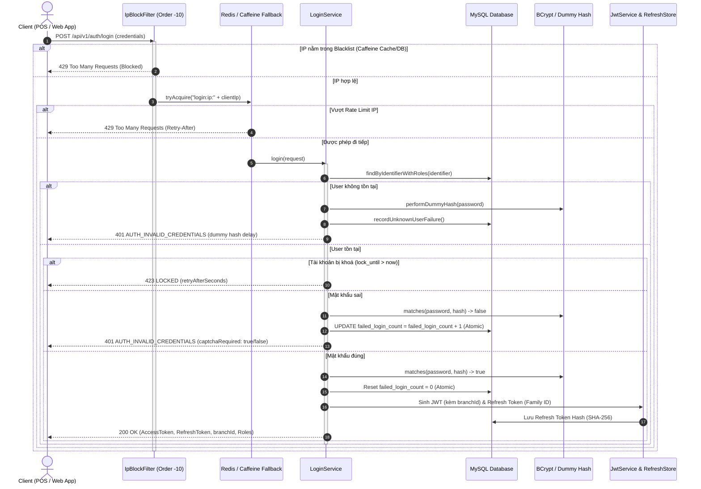

# Module Đăng Nhập & Xác Thực Quản Lý Cửa Hàng (Spring Boot 3 + MySQL + Redis)

Module Authentication chuẩn **Production-Grade**, thiết kế chuyên biệt cho hệ thống bán lẻ và chuỗi cửa hàng đa chi nhánh chịu tải cao với nhiều thiết bị đăng nhập đồng thời (Chủ cửa hàng, Quản lý, Thu ngân POS, Nhân viên kho).

---

## 1. Công nghệ sử dụng
- **Ngôn ngữ & Framework**: Java 17, Spring Boot 3.4.5, Spring Security 6, Spring Data JPA (Hibernate).
- **Cơ sở dữ liệu**: MySQL 8 (InnoDB, `utf8mb4_0900_ai_ci`), Schema migration tự động bằng **Flyway**.
- **Bộ đếm phân tán & Rate Limit**: Redis (với `RedisRateLimitStore` cho môi trường multi-instance), tích hợp cơ chế **Resilient In-Memory Fallback** (suy giảm mềm trên RAM từng node bằng Caffeine) khi Redis gặp sự cố để vừa đảm bảo tính sẵn sàng, vừa ngăn chặn DoS cạn kiệt CPU.
- **Token Security**: JWT (HS256) làm Access Token (15 phút), Refresh Token ngẫu nhiên (chỉ lưu hash SHA-256 trong database) với cơ chế **Token Rotation**, **Grace Period (5s)** và **Reuse Detection**.
- **Dual-Mode Token Transport**: Trả Refresh Token qua JSON body cho Desktop POS / Android Native App và qua **HttpOnly, Secure, SameSite=Strict Cookie** cho Web Browser (React/Vue Admin Dashboard) nhằm chống XSS.
- **Đa chi nhánh (Multi-Branch)**: Gắn `branchId` và danh sách chi nhánh uỷ quyền vào JWT Claims, hỗ trợ phân quyền dữ liệu bằng Spring Security SpEL `@branchSecurity.canAccess(#branchId)`.
- **Đồng bộ đa node tức thì**: Sử dụng **Redis Pub/Sub** để broadcast sự kiện vô hiệu hoá token (`auth:user:invalidate`), làm mới Caffeine User State Cache trên toàn bộ cluster ngay khi có sự kiện `logout-all` hoặc đổi mật khẩu.
- **Đồng bộ Job nhiều node**: **ShedLock** (`JdbcTemplateLockProvider` trên MySQL) bảo vệ các Scheduled Jobs dọn dẹp chạy an toàn trên một node duy nhất.
- **Bảo mật mật khẩu**: **BCrypt** độ mạnh 12 (kèm dummy hash chống timing attack).

---

## 2. Biến môi trường cần thiết

Trước khi khởi động ứng dụng, hãy thiết lập các biến môi trường sau:

| Biến môi trường | Bắt buộc | Giá trị mẫu | Mô tả |
| :--- | :---: | :--- | :--- |
| `JWT_SECRET` | **Có** | `c2VjdXJla2V5MTIzNDU2Nzg5MGFiY2RlZjEyMzQ1Njc4OTBhYmNkZWY=` | Chuỗi bí mật ký HMAC-SHA256 (tối thiểu 32 byte), **không bao giờ hardcode** |
| `DB_URL` | Không | `jdbc:mysql://localhost:3306/managershop?useUnicode=true&characterEncoding=utf8&connectionTimeZone=UTC` | Đường dẫn kết nối MySQL |
| `DB_USERNAME` | Không | `root` | Tài khoản MySQL |
| `DB_PASSWORD` | Không | `SecretPassword123` | Mật khẩu MySQL |
| `REDIS_HOST` | Không | `localhost` | Địa chỉ Redis Server |
| `REDIS_PORT` | Không | `6379` | Cổng kết nối Redis |
| `REDIS_PASSWORD` | Không | `""` | Mật khẩu Redis nếu có |
| `RATE_LIMIT_STORE`| Không | `redis` | Loại bộ đếm: `redis` (mặc định) hoặc `mysql` (chỉ dùng RAM Caffeine) |
| `SMTP_HOST` | Không | `smtp.gmail.com` | Máy chủ gửi email |
| `SMTP_PORT` | Không | `587` | Cổng SMTP |
| `SMTP_USERNAME` | Không | `notification@shop.com` | Email gửi thông báo |
| `SMTP_PASSWORD` | Không | `app-password` | Mật khẩu ứng dụng SMTP |

---

## 3. Hướng dẫn cài đặt & Khởi động

### 3.1. Khởi chạy cơ sở dữ liệu (MySQL & Redis)
Nếu sử dụng Docker:
```bash
docker run -d --name shop-mysql -p 3306:3306 -e MYSQL_ROOT_PASSWORD=root -e MYSQL_DATABASE=managershop mysql:8.0
docker run -d --name shop-redis -p 6379:6379 redis:7-alpine
```

### 3.2. Chạy ứng dụng
Trên Windows PowerShell:
```powershell
$env:JWT_SECRET="dGhpc0lzQVZlcnlTZWN1cmVKd3RTZWNyZXRLZXlGb3JUZXN0aW5nMTIzNDU2"
.\mvnw.cmd spring-boot:run
```

### 3.3. Chạy kiểm thử (Unit Tests)
```powershell
.\mvnw.cmd test '-Dtest=ClientIpResolverTest,IpBlockServiceTest,LoginServiceTest,RefreshTokenServiceTest,PasswordResetServiceTest,BranchSecurityExpressionTest,RedisRateLimitFallbackTest'
```

---

## 4. Hướng dẫn sử dụng API (Ví dụ `curl`)

Tất cả các API xác thực đều có tiền tố `/api/v1/auth`.

### 4.1. Cấu trúc lỗi thống nhất
Khi có lỗi, hệ thống luôn trả về format JSON chuẩn. Đặc biệt, nếu số lần đăng nhập sai chạm ngưỡng (mặc định $\ge 3$), trường `captchaRequired` sẽ trả về `true` để frontend bật widget xác thực Captcha:
```json
{
  "timestamp": "2026-10-15T10:20:00Z",
  "status": 401,
  "code": "AUTH_INVALID_CREDENTIALS",
  "message": "Tên đăng nhập hoặc mật khẩu không đúng",
  "retryAfterSeconds": null,
  "path": "/api/v1/auth/login",
  "captchaRequired": true
}
```

### 4.2. Đăng nhập (`POST /api/v1/auth/login`)
Chấp nhận `username` hoặc `email`.
```bash
curl -X POST http://localhost:8080/api/v1/auth/login \
  -H "Content-Type: application/json" \
  -d '{
    "identifier": "thungan01",
    "password": "Password123@",
    "deviceInfo": "POS-Quay-1"
  }'
```
**Response (200 OK):**
```json
{
  "accessToken": "eyJhbGciOiJIUzI1NiIsInR5cCI6IkpXVCJ9...",
  "refreshToken": "g8Hq2L9P-xY4zW1kM0vR7sT5uN2qE8wI3oA6dC9mB1f",
  "tokenType": "Bearer",
  "expiresIn": 900,
  "roles": ["CASHIER"],
  "branchId": 1,
  "branchName": "Chi nhánh Quận 1 (Trụ sở)",
  "captchaRequired": false
}
```
*Lưu ý đối với Web Client*: Nếu gửi kèm header `X-Client-Type: web`, máy chủ sẽ tự động đính kèm `Set-Cookie: refreshToken=...; HttpOnly; Secure; SameSite=Strict; Path=/api/v1/auth`.

### 4.3. Làm mới Access Token (`POST /api/v1/auth/refresh`)
Cơ chế **Token Rotation**: Trả về Access Token mới và Refresh Token mới.
```bash
# Đối với Native POS (gửi qua body)
curl -X POST http://localhost:8080/api/v1/auth/refresh \
  -H "Content-Type: application/json" \
  -d '{"refreshToken": "g8Hq2L9P-xY4zW1kM0vR7sT5uN2qE8wI3oA6dC9mB1f"}'

# Đối với Web Client (token tự động lấy từ HttpOnly Cookie)
curl -X POST http://localhost:8080/api/v1/auth/refresh \
  -H "X-Client-Type: web" \
  -b "refreshToken=g8Hq2L9P-xY4zW1kM0vR7sT5uN2qE8wI3oA6dC9mB1f"
```

### 4.4. Đăng xuất phiên hiện tại (`POST /api/v1/auth/logout`)
Thu hồi token family của phiên tương ứng (yêu cầu Access Token).
```bash
curl -X POST http://localhost:8080/api/v1/auth/logout \
  -H "Authorization: Bearer <ACCESS_TOKEN>" \
  -H "Content-Type: application/json" \
  -d '{"refreshToken": "g8Hq2L9P-xY4zW1kM0vR7sT5uN2qE8wI3oA6dC9mB1f"}'
```

### 4.5. Đăng xuất tất cả thiết bị (`POST /api/v1/auth/logout-all`)
Thu hồi toàn bộ Refresh Token của user và tăng `token_version` để vô hiệu hóa tức thì mọi Access Token đang còn hạn trên các thiết bị khác (đồng bộ tức thì qua Redis Pub/Sub).
```bash
curl -X POST http://localhost:8080/api/v1/auth/logout-all \
  -H "Authorization: Bearer <ACCESS_TOKEN>"
```

### 4.6. Quản lý phiên đăng nhập
- **Xem danh sách phiên**: `GET /api/v1/auth/sessions`
- **Thu hồi 1 phiên**: `DELETE /api/v1/auth/sessions/{id}`

### 4.7. Quên & Đặt lại mật khẩu
- **Quên mật khẩu**: `POST /api/v1/auth/forgot-password` (Chống User Enumeration, luôn trả về 200).
- **Đặt lại mật khẩu**: `POST /api/v1/auth/reset-password` (Dùng token từ email, kiểm tra trùng 3 mật khẩu gần nhất).
- **Đổi mật khẩu**: `POST /api/v1/auth/change-password` (Người dùng đang đăng nhập).

---

## 5. Các quyết định thiết kế kiến trúc quan trọng

### 5.1. Sơ đồ tuần tự xác thực (Sequence Diagram)


### 5.2. Giải pháp chống nghẽn và bảo vệ NAT IP chi nhánh cửa hàng
- **Vấn đề thực tế**: 10 quầy thu ngân POS và điện thoại kiểm kho tại một chi nhánh thường chia sẻ cùng một IP Public qua router NAT (thường là IP động của nhà mạng). Nếu chỉ chặn cứng theo IP, khi 1-2 nhân viên nhập sai mật khẩu, cả chi nhánh sẽ bị tê liệt hoàn toàn.
- **Giải pháp**:
  - Tách bạch ngưỡng đếm: Ngưỡng chặn toàn bộ IP (`maxFailuresPerIp = 50`) chỉ dùng để ngăn chặn tấn công DDoS/Botnet quy mô lớn.
  - Ngưỡng kiểm soát theo cặp `(IP + Identifier)` và khóa tài khoản nguyên tử ở cấp độ User giúp cách ly sự cố: Chỉ tài khoản vi phạm bị khóa tạm thời, các quầy POS khác vẫn hoạt động bình thường.
  - Tăng trần rate limit `loginPerMinutePerIp = 60` để phục vụ kịch bản các quầy POS đổi ca và đăng nhập đồng thời.

### 5.3. Cơ chế Resilient In-Memory Fallback khi Redis gặp sự cố
- **Rủi ro của Fail-Open thuần túy**: Khi Redis sập hoặc connection pool bị nghẽn, nếu cho qua tự do (`return true`), kẻ tấn công có thể spam hàng nghìn request vào `/login`. Do mỗi request băm BCrypt cost 12 tốn ~100ms CPU, CPU của máy chủ sẽ chạm ngưỡng 100% gây sập Tomcat và nghẽn pool kết nối MySQL.
- **Giải pháp**: `RedisRateLimitStore` tự động kích hoạt **Fallback In-Memory Rate Limiter (Caffeine)** trên RAM của từng node Spring Boot khi bắt ngoại lệ `DataAccessException`. Nhờ đó, người dùng thông thường vẫn đăng nhập được, trong khi máy chủ vẫn được che chắn trước các đợt DoS dồn dập.

### 5.4. Kiến trúc Đa chi nhánh & Phân quyền dữ liệu
- Bảng `branches` lưu thông tin từng cơ sở cửa hàng. Mỗi `User` được gắn với `branch_id` trực thuộc và danh sách `user_branches` uỷ quyền.
- Thông tin chi nhánh được mã hoá vào Claims của JWT (`bid`, `bids`).
- Hỗ trợ kiểm tra quyền dữ liệu trực tiếp trong Controller/Service bằng Spring Security SpEL:
  ```java
  @PreAuthorize("@branchSecurity.canAccess(#branchId)")
  @PostMapping("/branches/{branchId}/orders")
  public ResponseEntity<OrderDto> createOrder(@PathVariable Long branchId, ...)
  ```

### 5.5. Đồng bộ tức thì `token_version` qua Redis Pub/Sub
- `AuthUserCache` sử dụng Caffeine Cache nội bộ trên RAM (TTL 30s) để giảm thiểu truy vấn MySQL khi xác thực JWT trên mỗi request.
- Khi người dùng đổi mật khẩu hoặc quản trị viên thu hồi phiên (`logout-all`), sự kiện được publish lên Redis Topic `auth:user:invalidate`. Toàn bộ các node Spring Boot trong cụm lắng nghe và xóa cache ngay lập tức, vô hiệu hóa Access Token cũ mà không phải chờ hết TTL.

### 5.6. Cơ chế Captcha thông minh
- Khi người dùng nhập sai mật khẩu $\ge 3$ lần, `LoginService` phát hiện ngưỡng và trả về `captchaRequired: true` trong `ErrorResponse` (HTTP 401).
- Frontend nhận cờ này sẽ kích hoạt widget Captcha (Google reCAPTCHA / Cloudflare Turnstile). Từ lần đăng nhập thứ 4 trở đi, request bắt buộc phải đính kèm `captchaToken` hợp lệ.
