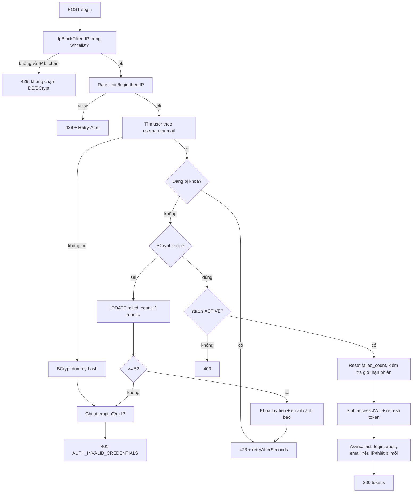
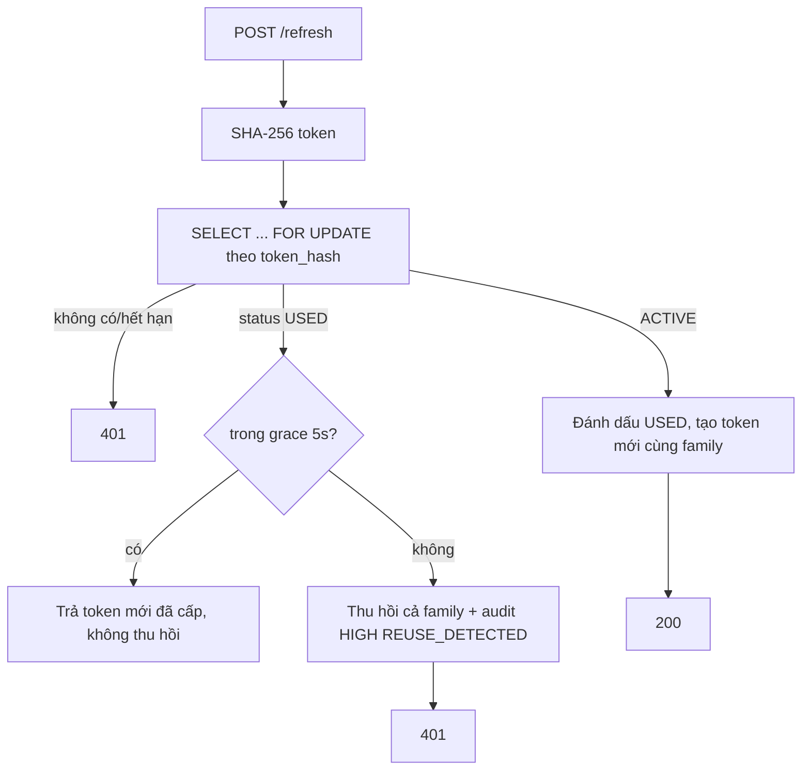
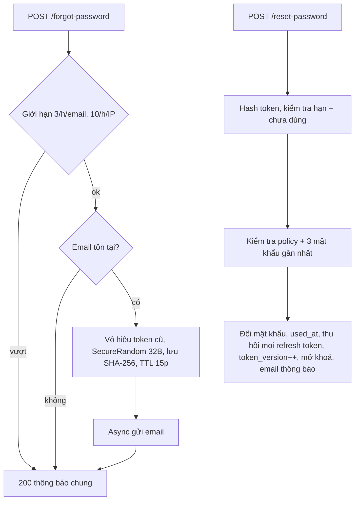

# Giai đoạn 1: Thiết kế module Authentication

Package: `com.thupo.managerShop.auth` · Spring Boot 3.4.x · Java 17 · MySQL 8

## 1. Kiến trúc

```
com.thupo.managerShop.auth
├── config        SecurityConfig, SecurityProperties (@ConfigurationProperties app.security), AsyncConfig, CorsConfig
├── controller    AuthController, SessionController, AdminAuthController
├── dto           request/ response (record)
├── entity        User, Role, RefreshToken, LoginAttempt, IpBlock, IpWhitelist, PasswordResetToken, PasswordHistory, AuditLog
├── repository    Spring Data JPA (+ query atomic UPDATE)
├── service       LoginService, RefreshTokenService, PasswordResetService, PasswordService, IpBlockService,
│                 AccountLockService, SessionService, AuditService, LoginAttemptRecorder (batch), EmailService
├── security      JwtService, JwtAuthenticationFilter, IpBlockFilter, ClientIpResolver, UserPrincipal
├── ratelimit     RateLimitStore, MySqlRateLimitStore, RedisRateLimitStore
├── captcha       CaptchaVerifier (interface)
├── exception     ErrorCode (enum), AuthException, GlobalExceptionHandler (@RestControllerAdvice)
└── job           CleanupJob (@Scheduled + ShedLock)
```

Filter chain: `IpBlockFilter` (trước Spring Security) → `JwtAuthenticationFilter` → controller.

## 2. Sơ đồ luồng

### 2.1 Login


### 2.2 Khoá tài khoản và chặn IP
```mermaid
flowchart LR
    F1[Login thất bại] --> A1[Bộ đếm account: MySQL atomic]
    F1 --> A2[Bộ đếm IP: RateLimitStore]
    A1 -- 5 lần --> L1[lock_until = now + durations[lock_level]; lock_level++]
    A2 -- ">20 lần fail/10p hoặc >10 username/10p" --> B1[ip_blocklist: level 1..4]
    B1 --> C1[Caffeine cache TTL ngắn trong IpBlockFilter]
```

### 2.3 Refresh rotation


### 2.4 Quên mật khẩu


## 3. Thiết kế DB

Script đầy đủ: [V1__auth_schema.sql](file:///d:/SpringBoot/managerShop/managerShop/src/main/resources/db/migration/V1__auth_schema.sql). Lý do index chính:

| Index | Lý do |
|---|---|
| `users.uk_username`, `uk_email` | Tra cứu login, đảm bảo duy nhất |
| `refresh_tokens.uk_token_hash` | Refresh tra theo hash; không lưu token gốc |
| `refresh_tokens (user_id, status)` | Danh sách phiên, đếm phiên, logout-all |
| `refresh_tokens.family_id` | Thu hồi cả họ khi reuse |
| `login_attempts (ip, created_at)`, `(username, created_at)` | Truy vấn admin và thống kê trong cửa sổ thời gian |
| `ip_blocklist.uk_ip` | Một dòng/IP, tái phạm thì tăng level |
| `password_reset_tokens (user_id, created_at)`, `(requested_ip, created_at)` | Giới hạn tần suất yêu cầu |
| `*_created_at` | Job dọn dẹp xoá theo thời gian |

Dọn dẹp: `login_attempts` > 90 ngày, token hết hạn, IP block hết hạn. Khi bảng rất lớn nên partition theo tháng (`PARTITION BY RANGE`) cho `login_attempts` và `audit_logs`. Lưu ý partition yêu cầu cột phân vùng nằm trong khoá chính, nên cần đổi PK thành `(id, created_at)`. Giai đoạn đầu dùng `DELETE` theo lô (LIMIT 5000), chưa cần partition.

Ghi chú: thêm bảng `shedlock` cho job dọn dẹp nhiều instance.

## 4. Danh sách API (`/api/v1/auth`)

| Method | Endpoint | Quyền | Request | Response | Lỗi |
|---|---|---|---|---|---|
| POST | `/login` | public | `{identifier, password, deviceInfo?}` | `{accessToken, refreshToken, expiresIn, tokenType, roles, captchaRequired}` | 400, 401, 403, 423, 429 |
| POST | `/refresh` | public | `{refreshToken}` | như login | 400, 401, 429 |
| POST | `/logout` | auth | `{refreshToken}` | 204 | 401 |
| POST | `/logout-all` | auth | - | 204 | 401 |
| POST | `/forgot-password` | public | `{email}` | 200 thông báo chung | 400, 429 |
| POST | `/reset-password` | public | `{token, newPassword}` | 200 | 400, 410 (token hết hạn/dùng rồi) |
| POST | `/change-password` | auth | `{currentPassword, newPassword}` | 200 | 400, 401 |
| GET | `/sessions` | auth | - | danh sách `{id, deviceInfo, ip, createdAt, current}` | 401 |
| DELETE | `/sessions/{id}` | auth | - | 204 | 401, 404 |
| POST | `/admin/users/{id}/unlock` | OWNER, MANAGER | - | 200 | 401, 403, 404 |
| DELETE | `/admin/ip-blocks/{ip}` | OWNER, MANAGER | - | 204 | 401, 403, 404 |
| GET | `/admin/login-attempts` | OWNER, MANAGER | query: `page,size,ip,username,success,from,to` | phân trang | 401, 403 |

Ví dụ login:
```json
// request
{ "identifier": "thungan01", "password": "Abc12345", "deviceInfo": "POS-Quay-1" }
// 200
{ "accessToken": "eyJ...", "refreshToken": "base64url...", "tokenType": "Bearer", "expiresIn": 900,
  "roles": ["CASHIER"], "captchaRequired": false }
// 423 (header Retry-After: 900)
{ "timestamp": "2026-10-05T10:20:00Z", "status": 423, "code": "AUTH_ACCOUNT_LOCKED",
  "message": "Tài khoản tạm thời bị khoá", "retryAfterSeconds": 900, "path": "/api/v1/auth/login" }
```

Mã lỗi (enum `ErrorCode`): `AUTH_INVALID_CREDENTIALS` (401), `AUTH_ACCOUNT_LOCKED` (423), `AUTH_ACCOUNT_DISABLED` (403), `AUTH_IP_BLOCKED` (429), `AUTH_RATE_LIMITED` (429), `AUTH_TOKEN_INVALID` (401), `AUTH_TOKEN_EXPIRED` (401), `AUTH_REFRESH_REUSED` (401), `AUTH_RESET_TOKEN_INVALID` (410), `AUTH_PASSWORD_POLICY` (400), `AUTH_PASSWORD_REUSED` (400), `VALIDATION_ERROR` (400), `FORBIDDEN` (403), `NOT_FOUND` (404).

## 5. Quyết định thiết kế cần bạn duyệt

| # | Vấn đề | Phương án đề xuất | Lựa chọn khác / trade-off |
|---|---|---|---|
| 1 | Bộ đếm IP và rate limit | **Đã chốt: chạy nhiều instance, có Redis.** `RedisRateLimitStore` là mặc định (`INCR` + `EXPIRE` cho cửa sổ đếm, `SADD` cho đếm username khác nhau theo IP). Caffeine (TTL ngắn) chỉ làm cache đọc danh sách IP bị chặn trong `IpBlockFilter`. `MySqlRateLimitStore` giữ làm dự phòng cho profile không có Redis (dev/test). Bộ đếm theo tài khoản và trạng thái khoá vẫn ở MySQL | Nếu Redis chết: rate limit **fail-open** (cho qua, ghi cảnh báo), nhưng ngưỡng khoá tài khoản ở MySQL vẫn hoạt động nên không mất lớp bảo vệ chính. IP bị chặn lưu bền ở MySQL, nạp lại vào cache khi cần |
| 2 | Vô hiệu access token khi user bị disable | `token_version` nhúng vào JWT; filter so với giá trị trong cache user (Caffeine TTL 30s) | Blocklist `jti`: tốn lưu trữ, nhưng thu hồi từng token. TTL 30s nghĩa là có độ trễ tối đa 30s |
| 3 | Race refresh đồng thời | `SELECT ... FOR UPDATE` + grace period 5s: trong 5s dùng lại token USED thì không coi là tấn công | Chỉ khoá hàng: request thứ 2 sẽ bị coi là reuse và đăng xuất người dùng oan |
| 4 | Chống DoS khoá tài khoản | Đếm theo cặp (username + IP) cho ngưỡng khoá; thêm ngưỡng tổng theo username cao hơn (ví dụ 20) để chặn tấn công phân tán | Chỉ đếm theo username: kẻ tấn công khoá được tài khoản của bất kỳ ai |
| 5 | Ký JWT | HS256, secret từ biến môi trường `JWT_SECRET` (>=32 byte) | RS256: an toàn hơn khi nhiều service cần verify, nhưng phải quản lý khoá. Hiện chỉ 1 app nên HS256 đủ |
| 6 | Ghi `login_attempts` | Queue trong bộ nhớ, flush mỗi 3 giây hoặc 500 bản ghi (batch insert) | Mất tối đa vài giây log khi app crash. Chấp nhận được vì bộ đếm bảo mật không dựa vào bảng này |
| 7 | Thư viện JWT | `jjwt` 0.12.x | `nimbus-jose-jwt` (có sẵn khi dùng oauth2-resource-server) |
| 8 | Phát hiện thiết bị mới | So sánh IP + hash User-Agent với các phiên trước đó | Chính xác hơn cần device fingerprint (để dành bản nâng cấp) |

HikariCP đề xuất: `maximum-pool-size: 20`, `minimum-idle: 5`, `connection-timeout: 3000`, `max-lifetime: 1800000`. BCrypt chiếm CPU nhiều hơn DB, nên cân nhắc giới hạn số login đồng thời bằng semaphore.

### Cần bổ sung vào `pom.xml` ở Giai đoạn 2
`spring-boot-starter-security`, `spring-boot-starter-data-redis`, `io.jsonwebtoken:jjwt-api/impl/jackson` 0.12.x, `com.github.ben-manes.caffeine:caffeine`, `net.javacrumbs.shedlock:shedlock-spring` + `shedlock-provider-jdbc-template`, `org.projectlombok:lombok`; test: `spring-security-test`, `org.testcontainers:mysql` + `junit-jupiter` (thêm container Redis cho integration test).

## 6. Đã làm trong giai đoạn này
- Chuyển [pom.xml](file:///d:/SpringBoot/managerShop/managerShop/pom.xml) về Spring Boot 3.4.5, bỏ Spring Cloud Gateway.
- Tạo [V1__auth_schema.sql](file:///d:/SpringBoot/managerShop/managerShop/src/main/resources/db/migration/V1__auth_schema.sql).

Chờ bạn duyệt mục 5, sau đó chỉ định giai đoạn tiếp theo.
